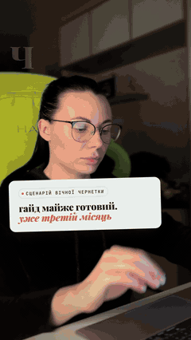
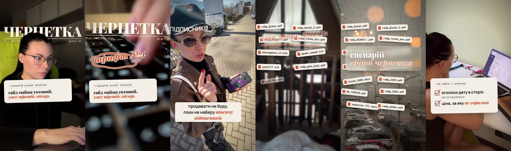

# claude-reelsmith 🎬

**Reels and TikToks from your own footage, directed and edited by Claude Code.**
You approve an idea and a script. Claude writes it, voices it, picks fresh shots from your camera roll, cuts them to the words, adds motion effects and subtitles, mixes sound, and hands you a post-ready MP4, a cover and a caption. Your time: about 10 minutes per reel.

<p align="center"></p>

▶ **[Watch the full demo reel](https://github.com/lalimi/claude-reelsmith/releases/download/v0.1.0/eternal-draft-demo.mp4)** — 61 s, Ukrainian voice-over, 15 of the author's own clips, built in one session with this repo.

---

## What's inside

| Skill | What it does |
|---|---|
| 🎬 **reel-director** | The director. Runs the job end to end, picks the story structure, decides which 3–5 effects go on which beat, plans transitions and sound, then reviews the cut like a critic before you see it. |
| ✍️ **reel-script** | Scroll-stopping scripts from 4 structures reverse-engineered from viral reels (contrarian hook, series with cliffhanger, list of factors, "the scenario of…"). Analyses reels you paste, writes in your language. |
| 🎞 **footage-scout** | Picks fresh clips from a folder or a shared iCloud Photos album in your browser, downloads only what the edit needs, makes contact sheets, skips private details, keeps a used-footage log. |
| ✂️ **reel-builder** | The editor + motion designer: one `reel.json` → finished 1080×1920 MP4 with subtitles, cards, effects, music and a −14 LUFS mix. |
| 🗣 **talking-head-edit** | For videos where you talk to camera: cleans audio, cuts fillers, word-by-word captions, layout changes, UI cards. |
| 🔊 **reel-capcut** | Sends the reel to an editable **CapCut** draft with library sound effects on every transition, so you can swap music and sounds by ear. |

**Engine effects** (all keys in `reel.json`, see [docs/effects.md](docs/effects.md)):

<p align="center"></p>

cover story + frame break · orbit text around your head · doodle boil · glass type · headline wall · checklist · black-and-white → colour burst · photo montage with camera date stamp · punch-ins on accent words · zoom-through and whip transitions · hook and end cards · stamps · subtitles with accent words · Reels/TikTok safe-zone QA sheet.

## Install

Requirements: **macOS** (recommended — person masks for cover/orbit use Apple Vision) or Linux without those two effects; [Claude Code](https://claude.com/claude-code); `ffmpeg`, `node` ≥ 20, `python3` ≥ 3.10 (`brew install ffmpeg node python`).

**As a Claude Code plugin** (recommended):
```
/plugin marketplace add lalimi/claude-reelsmith
/plugin install reelsmith@lalimi
```
Then once, in any terminal or by asking Claude: `reelsmith setup` (2–4 min: Python venv with faster-whisper, Playwright Chromium, the mask tool).

**Or manually:**
```bash
git clone https://github.com/lalimi/claude-reelsmith && cd claude-reelsmith
./install.sh --link-skills      # venv + Chromium + `reelsmith` on PATH + skills into ~/.claude/skills
```
Check anytime with `reelsmith doctor`.

### Connectors (all optional)
- **Claude in Chrome** — lets Claude browse your shared photo album and the ElevenLabs web UI in *your* logged-in browser. Claude never types your passwords.
- **CapCut MCP** — bundled (`.mcp.json`); sign in once via `/mcp`. Needed only for the CapCut route → [docs/capcut.md](docs/capcut.md).
- **ElevenLabs** — TTS voice-over if you don't record your own → [docs/voice.md](docs/voice.md).

## Quick start

Open Claude Code in a folder for your reels and say:

> Make me a 45-second reel for my Instagram about why people never launch their course. My clips are in the shared album "Reels" — use only new ones. Voice: my recording in voice.m4a.

The director asks a few questions, shows you a script to approve, then builds. Or drive the engine yourself:

```bash
reelsmith new reels/launch          # folder + template reel.json
reelsmith sheet reels/launch/src/*  # contact sheets to pick moments
reelsmith build reels/launch --stills   # fast preview + safe-zone QA sheet
reelsmith build reels/launch        # final MP4, cover.jpg, caption.txt in reels/launch/out/
```

A real 17-segment example with every effect: [`examples/chernetka/reel.json`](examples/chernetka/reel.json) (footage not included).

## How it works

```
idea ─► reel-script ─► approved script ─► voice (yours or ElevenLabs) ─► faster-whisper word timings
                                                                              │
footage-scout ─► fresh clips ─► reel.json (beats, effects, transitions) ◄─────┘
                                     │
reel-builder: HTML page per frame (Playwright) ─► ffmpeg ─► MP4 + cover + caption ─► director's critic pass
                                     │
                         (optional) reel-capcut ─► editable CapCut draft with sound effects
```
Every frame is an HTML page rendered by headless Chromium, so effects are plain CSS/SVG/JS in `engine/template.html` — easy to extend.

## Privacy
Your footage, voice and renders stay on your machine (`.gitignore` excludes `src/`, `out/`, `frames/`). Nothing is uploaded unless you use the CapCut route. The skills check clips for other people's messages, car plates and street names before using them.

## Support the project 💛

This is free and open source, built in Ukraine 🇺🇦 by an indie founder. If it saved you a few hours of editing, you can buy me a coffee:

<p align="center">
  <a href="https://base.monobank.ua/d/9J99rx8GNQAWMh/"></a><br><br>
  <a href="https://base.monobank.ua/d/9J99rx8GNQAWMh/"></a><br>
  <sub>Scan with your phone camera or tap — any Visa / Mastercard, Apple Pay, Google Pay.</sub>
</p>

Built by **Lalita** ([@lali.mi](https://instagram.com/lali.mi)), founder of [BlackSea](https://blacksea.in.ua) — a marketplace for Ukrainian creators of digital products. Questions, ideas, collaborations: [lali@blacksea.in.ua](mailto:lali@blacksea.in.ua).

## Credits & license
MIT — see [LICENSE](LICENSE). Talking-head prep scripts adapted from [nicolapocock/claude-reel-editor](https://github.com/nicolapocock/claude-reel-editor) (MIT). Fonts under SIL OFL 1.1. Full list: [THIRD_PARTY_NOTICES.md](THIRD_PARTY_NOTICES.md).

Contributions welcome — especially the effects not built yet: couch wall, UI world, phone mockup, green screen, paper cut, vertigo.
