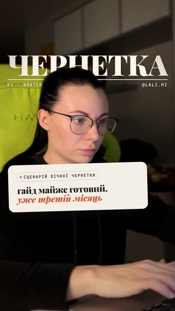
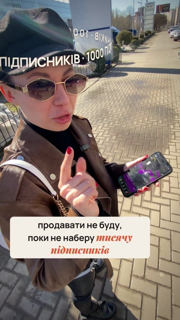
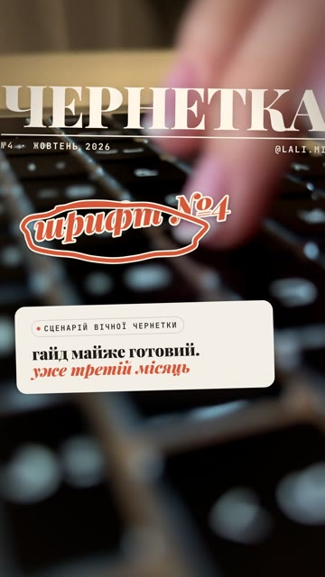
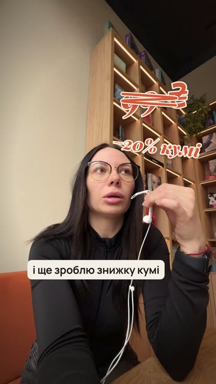
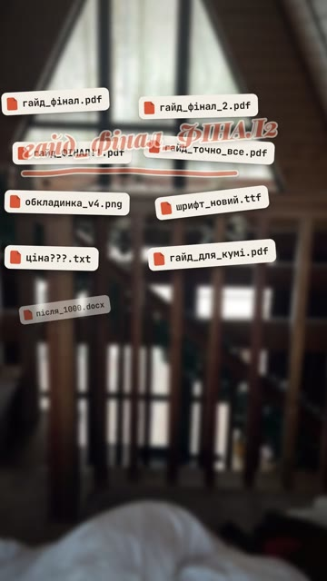
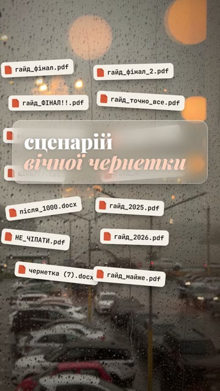
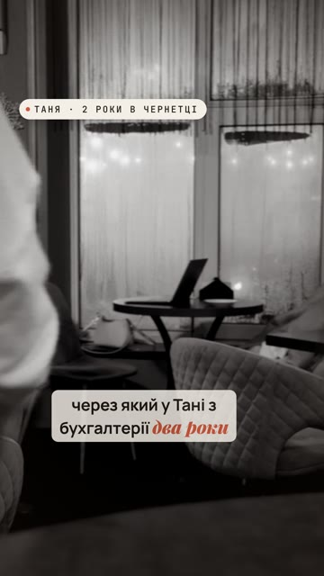
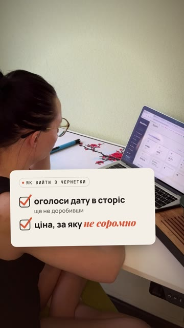
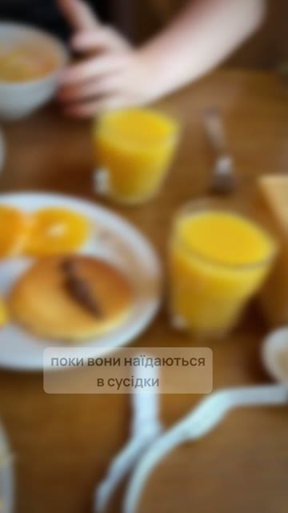
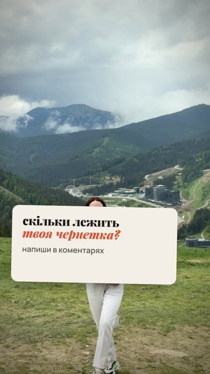

# Effects catalogue

All frames below come from one real reel built with this engine ("Сценарій вічної чернетки" — *The eternal-draft scenario*, 61 s, Ukrainian, `examples/chernetka/reel.json`). Every effect is a key in `reel.json`; exact fields are in `skills/reel-builder/SKILL.md`.

| | | |
|---|---|---|
|  **Cover story + frame break** `cover` + segment `cut` — magazine masthead, letters drop in, the person stands in front of the title (macOS Vision mask). |  **Orbit** `orbit` — a phrase circling the head; the back half passes behind the person. |  **Doodle boil** `doodles` — handwritten notes written on stroke by stroke, wobbling every 3 frames. |
|  **Strike-through** `doodles` kind `strike` — crossing out a price or a promise. |  **Headline wall** `wall` — tiles (file names, headlines, notifications) pile up. |  **Glass type** `glass` — a title on frosted glass over the footage (here over the wall). |
|  **Black & white + stamp** `look: "bw"` + `stamps` — "someone else's story"; music muffles. |  **Checklist** `checklist` — steps tick on as they are said; replaces subtitles while up. |  **Zoom-through cut** segment `in: "zoom"` — the outgoing shot rushes in, the next lands from a zoom. Also `in: "whip"`. |
|  **End card** `end` — question + call to action + handle over a calm final shot. | | |

Also built in: hook card (`hook`), subtitles with accent words (automatic from `script`), punch-ins on accent words (`punch`, automatic), grey → colour burst (`look: "burst"`), photo montage with camera date stamp (`look: "memory"`, `date`), slow push / tilt / pull-out moves, slow motion (`rate`), crop punch-ins (`crop`).

## Choosing effects
Use 3–5 per reel, each on the beat it explains — see the table in `skills/reel-director/SKILL.md`. Effects must read at phone size on the first watch.

## Not built yet (ideas welcome)
couch wall · UI world · phone mockup · green screen · paper cut · vertigo (dolly zoom) · chart grow as an engine key. Pull requests welcome.
